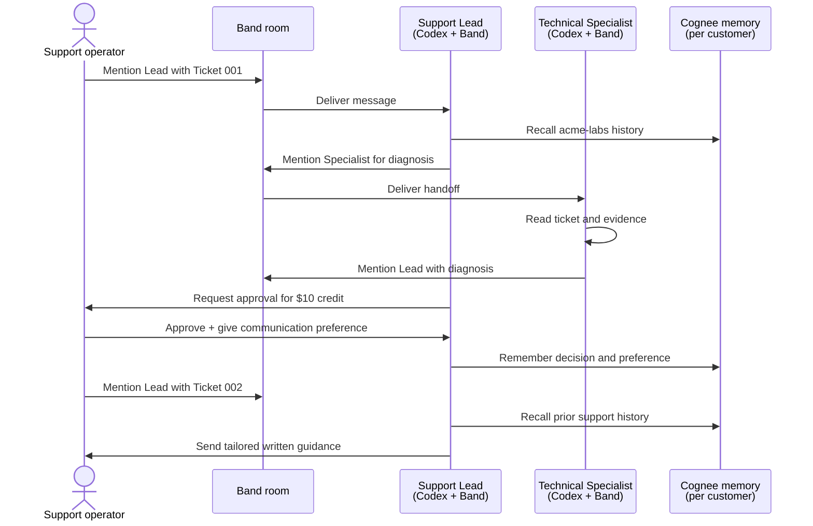

# Support Relay

Support Relay is a small, end-to-end demonstration of AI-assisted customer support. Two remote agents collaborate in a [Band](https://band.ai) room to resolve synthetic API tickets: a Support Lead owns the customer conversation and a Technical Specialist diagnoses the evidence. The Lead uses [Cognee](https://www.cognee.ai/) as durable, customer-scoped memory, so a later ticket can use decisions and communication preferences from an earlier interaction.

The project demonstrates agent routing, technical handoff, human approval for a concession, and memory-informed follow-up. It is not a production ticketing, CRM, billing, or customer-data system.



## Architecture

The TypeScript runner in `src-ts/band-agent.ts` starts one Band remote-agent identity per process. It loads the role-specific identity from `agent_config.yaml`, subscribes to rooms that already contain that identity, and connects Band's `CodexAdapter` to a local Codex CLI process. The adapter binds each demo room to this repository, allowing the agents to read ticket fixtures and role prompts rather than working in an empty room workspace.

The two roles are intentionally separated:

- **Support Lead** receives the customer-facing mention, reads the ticket, retrieves the customer's memory before drafting, delegates technical work, requests human approval for a credit, and returns concise written guidance.
- **Technical Specialist** receives the Lead's @mention, inspects the supplied evidence, reports cause, confidence, remediation, and verification, then hands the diagnosis back to the Lead. It does not set customer policy or approve concessions.

Role boundaries and behavior are supplied as Codex prompt sections in `prompts/support_lead.md` and `prompts/technical_specialist.md`. Band requires agent messages to mention a room participant, so each role uses @mentions for replies and handoffs.

`recall_customer_memory` and `remember_customer_memory` are custom tools provided to the Codex-backed roles. They launch `scripts/cognee_memory.py`, a small bridge to Cognee. The bridge normalizes a customer ID and maps it to an isolated dataset such as `support_relay_acme-labs`; it never uses a requester's display name as the durable key. Cognee persists facts such as an approved credit, diagnosis, and a preference for written instructions. The next ticket retrieves that context before the Lead responds.

The repository also retains a Python Band runner in `src/support_relay/` as an implementation reference. The supported demo path on this Windows machine is the TypeScript runner because its Python SDK's native dependency may be blocked by local application-control policy.

## Prerequisites

- A **Band account** with access to create remote-agent identities and rooms. Create two identities named `Support Lead` and `Technical Specialist`; save each agent ID and API key when Band shows them.
- **Codex Desktop / Codex CLI**, available locally and authenticated. The runner normally discovers Codex Desktop's installed `codex.exe`. If it is elsewhere, set `CODEX_COMMAND` in `.env` to its full path.
- **Node.js 22 or newer** and npm for the supported TypeScript runner.
- **Python 3.11+** and a virtual environment containing the dependencies in `pyproject.toml`, including Cognee. Cognee may download local embedding/extraction models on its first memory operation, so allow internet access and several minutes for that one-time setup.
- A Band room with the two remote identities and a human support operator as participants. The demo uses Band's production endpoints by default; use `BAND_REST_URL` and `BAND_WS_URL` only for another Band environment.

## Install and configure

Clone the repository, then install both runtime layers:

```powershell
npm install
python -m venv .venv
.\.venv\Scripts\Activate.ps1
python -m pip install --upgrade pip
python -m pip install -e .
```

Copy the example configuration files and replace the placeholders with the two Band identities you created. Keep these local files private: both are ignored by Git.

```powershell
Copy-Item .env.example .env
Copy-Item agent_config.yaml.example agent_config.yaml
```

In `agent_config.yaml`, fill in `agent_id` and `api_key` for both `support_lead` and `technical_specialist`. In `.env`, optionally set `CODEX_COMMAND` only when Codex is not installed in the normal Desktop path.

### Build and validate

The development runners execute TypeScript directly with `tsx`; a build is not required to run the demo. Use the following commands before committing or when you need compiled JavaScript in `dist/`:

```powershell
npm run typecheck
npm run build
```

`npm run build` compiles `src-ts/` to `dist/`. Generated Node dependencies, build output, coverage data, and TypeScript incremental-build metadata are excluded from Git by `.gitignore`.

Start each role from a separate PowerShell window at the project root:

```powershell
npm run band:lead
npm run band:specialist
```

Both processes should print their role and Codex executable, then remain running while they listen for Band room messages.

### Verify Band delivery first (optional)

If a mention does not produce a response, stop the real runner for that role and use the lightweight echo adapter. It confirms room subscription and mention routing without starting Codex:

```powershell
npm run band:lead:echo
```

Mention `@Support Lead` in the room; it should reply with an echo. Repeat with `npm run band:specialist:echo` for the specialist. Once delivery is confirmed, restart the real roles.

## End-to-end demo

1. In Band, create a room and add the human operator, `Support Lead`, and `Technical Specialist`. The processes may be started before or after adding them; the runners automatically subscribe to existing rooms.
2. With both real role processes running, send this in the room:

   ```text
   @Support Lead Please handle Ticket 001 in demo/ticket_001.md.
   ```

   The Lead recalls any existing `acme-labs` history and asks the Specialist to inspect `demo/ticket_001.log`. The log shows an expired API key; the Specialist returns safe rotation guidance. The Lead should request human approval before promising the $10 credit.
3. Respond in the same room with the approval and a durable preference:

   ```text
   @Support Lead Approved: grant the $10 credit. This customer needs written
   instructions first and cannot join troubleshooting calls.
   ```

   The Lead stores the approved decision, diagnosis, and preference with Cognee. Wait for confirmation before continuing.
4. Create a **new** Band room with the same three participants, then send:

   ```text
   @Support Lead Please handle Ticket 002 in demo/ticket_002.md.
   ```

   The Lead must recall `acme-labs` memory before replying. A successful demo gives written 429/rate-limit troubleshooting (pacing or queueing the import, exponential backoff with jitter, honoring `Retry-After`, and monitoring retries) and acknowledges that the prior written-instructions preference changed the approach.

Use a fresh second room to make the cross-session memory behavior obvious. Cognee data is local and persistent; it remains available across agent restarts until its local storage is removed.

## Repository map

| Path | Purpose |
| --- | --- |
| `src-ts/band-agent.ts` | Supported Band/Codex runner and Cognee custom tools. |
| `src-ts/band-echo.ts` | Band-only diagnostic runner. |
| `prompts/` | Role-specific instructions and handoff boundaries. |
| `scripts/cognee_memory.py` | Customer-scoped Cognee remember/recall bridge. |
| `demo/` | Synthetic tickets and the Ticket 001 diagnostic log. |
| `agent_config.yaml.example`, `.env.example` | Safe configuration templates. |
| `src/support_relay/` | Python reference implementation, not the default Windows path. |
| `IMPLEMENTATION_PLAN.md` | Current milestones and deferred work. |

## Security and data notes

Never commit `agent_config.yaml` or `.env`; they can contain Band credentials and a local Codex path. Keep the synthetic demo data separate from real customer data. Before adapting this demonstration for production, add authentication and authorization controls, secret management, retention/deletion policy, audit logging, robust approval workflows, and integration-specific privacy reviews.
